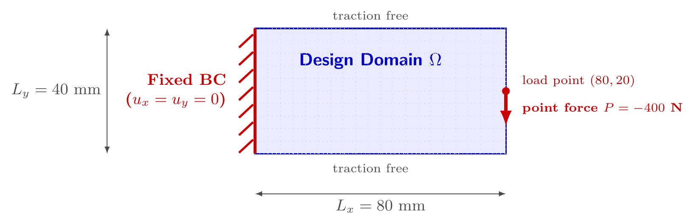

# 工程基准问题

没有解析解的工程问题：载荷是真实物理载荷（集中力、线载荷、边界牵引），不是从精确解反推的体力。实现位于 `soptx.problems.benchmarks`，公开类从 `soptx.problems` 导入；每个类一份模型文档，索引见[上级 README](../README.md)。

## 载荷对象与分组

问题类通过 `loads()` 返回结构化载荷对象，契约为 `PointForce`、`LineTraction`、`BoundaryTraction` 与 `BodyForce`（`soptx.protocols.loads`）；LFEM、Hu--Zhang 与子结构路径分别解释同一组物理载荷对象。

按载荷对象类型分四组。组别决定离散路径、哪些分析器能消费，以及需要检查哪些离散规则：

| 组 | 载荷对象 | 离散路径 | Hu--Zhang 可消费 |
| --- | --- | --- | --- |
| A | `PointForce` | 按形函数分配到节点，`assemble_point_force` | 否，`_validated_loads` 报 `TypeError` |
| B | `LineTraction` | 命中节点按线单元算一致节点力，`project_line_traction` | 否，同上 |
| C | `BoundaryTraction`，载荷区是整条边界 | 面积分 / 迹强插值 | 是 |
| D | `BoundaryTraction`，载荷区是边界上一段 | 面积分 / 迹强插值 | 是 |

C 与 D 的差别只在载荷区是不是整条边界，而这一条决定了两条离散规则要不要逐个算例检查：

| | A、B 组 | C 组 | D 组 |
| --- | --- | --- | --- |
| 载荷区端点与网格是否对齐 | 不适用 | 载荷区端点是几何角点，对任何网格都对齐 | 分析器构造时自动检查 |
| 载荷区标记的判定粒度 | 不适用 | `marker` 无排除项，不会触发 | 写新模型时检查 |
| 额外验证 | 无 | 无 | `check_boundary_load_resultant` |

两条规则的实现口径见 [`load-handling-implementation.md`](../../fem/load-handling-implementation.md) 的 2.1、2.2 节（面 / 边重心判定）与 3.3 节（端点对齐检查）。

## 验证判据

没有解析解，验证依据两条数值判据：

1. **真相对残差** $\|Ku - F\| / \|F\|$；
2. **载荷等效性** $\left|\sum F_{\sigma_h} - P\right|$，等效节点力装配无丢力、无多分力，且必须在 `apply_bc` 之前测量，否则被强加自由度吞掉的载荷不可见。

两条判据都只验证装配，不验证收敛。收敛阶验证要求连续解具备 $H^1$ 正则性，A、B 组的奇异载荷不满足（见 A 组），因此论文的收敛算例取 D 组的 `HalfFixedFixedBeamPatch2d`。

## A 组：集中力

载荷对象是 `PointForceLoad`，作用点与总力绑定在同一个对象上。模型不提供网格剖分数，`LagrangeFEMAnalyzer` 与子结构全尺度载荷共用 `assemble_point_force(space, load)`，按实际位移空间形成 $\boldsymbol f_a = N_a(\boldsymbol x_P)\boldsymbol P$。首轮非节点点力支持标准顶点顺序的轴对齐 Q1 六面体；其他网格保留精确节点点力，不支持的非节点点力明确报错。共享面或边上的点仅装配一次，不吸附到最近节点。子结构先装配细网格载荷，再作接口迹投影；涉及子结构内部自由度载荷时仍明确拒绝。

形函数分配不引入载荷数值积分误差：$\delta$ 与基函数配对就是基函数在该点的取值，不含求积误差。它不保证解收敛：$d \geqslant 2$ 时 $\delta \notin H^{-1}$，连续问题的解不在 $[H^1(\Omega)]^d$ 中（二维 $\boldsymbol{u} \sim \log r$，三维 $\boldsymbol{u} \sim r^{-1}$，应变能发散）：

| 性质 | 结论 |
| --- | --- |
| 固定 $h$ 下的可解性 | 成立，点值泛函在有限维 $V_h$ 上有界 |
| $h \to 0$ 的全局收敛 | 不成立，二维 $H^1$ 范数按 $O(\log(1/h))$ 增长，加载点位移无极限 |
| 远场收敛 | 在不含作用点的子域上仍收敛 |
| 加载点位移、邻域应力与柔顺度 | 随 $h$ 无极限；固定网格下仍是良定义的优化目标，但跨网格不可比，不能作收敛判据 |

适定性推导见 `dut-postdoc:concepts/external-loads.md` §3。

Hu--Zhang 混合元拒绝这类载荷：混合位移空间 $V = [L_2(\Omega)]^d$ 没有连续点值定义，应力法向迹空间也容纳不下点测度。需要用混合法处理集中力时，先在物理特征尺度上把它正则化为局部均布牵引，即改用 D 组的形式。

## B 组：线载荷

载荷对象是 `LineTractionLoad`，描述作用在一条直线上的总力。`project_line_traction` 把命中节点按线方向排序，每 `degree` 个区间归为一个 `degree` 阶 Lagrange 线单元做积分，`degree` 必须等于提供节点坐标的位移空间阶次，否则节点数与单元划分对不上。Hu--Zhang 混合元同样拒绝这类载荷，理由与 A 组相同。

三维 MBB 梁（`HalfMBBBeamLine3d`、`FullMBBBeamLine3d`）是对应二维 A 组模型沿 $z$ 的拉伸，二维集中力随之拉伸为线载荷，归入本组。

## C 组：满布边界牵引

载荷区是一整条（面）边界：端点就是几何角点，对任何网格都与网格面对齐；`marker` 由整条边界的坐标判定拼成，没有排除项。位移元按面积分弱施加，Hu--Zhang 在应力法向迹自由度上强插值，两条路径都不需要额外处理，D 组那两条检查在这里恒不触发。

## D 组：局部边界牵引

载荷区是边界上一段长度有限的区段。本组模型多由 A 组的集中力正则化而来：把合力 $P$ 按物理特征尺度（接触宽度、垫板长度）摊到边界上一段宽度 $l$ 的区间，成为强度 $P/l$ 的均布牵引。以悬臂梁为例，左为经典的集中力形式，右为正则化后的 `CantileverMiddlePatch2d`：

| 集中力 | 区段均布牵引 |
| --- | --- |
|  |  |

正则化的原因有两条。其一，Hu--Zhang 混合元把牵引作为应力法向迹强施加，边界数据必须是边界上的函数，Dirac 测度装不下，分析器对 `PointForce` 直接报错。其二，集中力下连续解不在 $[H^1]^d$ 中，加载点位移、柔顺度与邻域应力随网格发散；区段牵引下解 $H^1$ 正则，两条离散路径才能在同一离散载荷上比较。正则化不消除奇异性，只把它从加载点移到区段两端并减弱为可积的幂律：牵引在端点跳变，应力约束算例仍要在端点附近做豁免与实体保留，端点坐标由 `traction_patch_endpoints` 给出。

本组模型共用同一套离散规则，写新模型时逐条检查。

### 检查一：载荷区端点是否落在网格节点上

端点落在网格面内部时，该面上的被积函数在面内跳变，两条离散路径看到的离散载荷都不对，且都不报错：

| 路径 | 表现 |
| --- | --- |
| Lagrange 位移元 | 高斯积分作用在面内跳变的被积函数上，等效节点力不精确 |
| Hu--Zhang 混合元 | 迹空间跨面连续，跳变点上只有一个单值自由度，阶跃根本表示不出来 |

端点对不对齐由网格决定，不是模型的固有属性：加密网格能让它消失。`load_width` 是物理特征尺度，由建模确定后固定，不作为对齐网格的旋钮（见 `dut-postdoc:concepts/external-loads.md` §3.4）。未注入 `traction` 的模型（`uses_step_traction` 为真）按整边选取施加牵引，两个分析器构造时经 `soptx.fem.check_traction_patch_alignment` 自动检查端点对齐，不对齐即报错。确实无法对齐时，用 `traction` 参数注入 `project_patch_traction_to_p1_trace` 投影出的连续 P1 迹载荷：几何、材料与边界标记全部不变，只替换牵引函数，两条路径由此看到同一个离散载荷泛函。

### 检查二：`marker` 的排除项是否压在载荷区端点上

`marker` 只回答"这条边（面）属不属于牵引边界"，按边重心判定一次；载荷区形状由 `value` 函数逐点决定。`marker` 里如果有排除项（对称面、位移边界），而载荷区端点正好落在排除线上，强施加路径上就会出现：`value` 给出非零牵引，`marker` 把整条边抹掉，而该迹自由度已被登记为强约束，载荷缺失被改写成强加 $\sigma_{nn} = 0$。这一条与网格无关，是模型的固有属性，加密网格不会让它消失。

装配完成、施加边界条件之前，用 `soptx.fem.check_boundary_load_resultant` 把离散合力与解析合力比对，把这两种静默偏差变成一个可断言的量。

## 接口约定

所有类继承 `benchmarks/_base.py` 的 `ElasticityBenchmark`：构造参数顺序 `domain, P, <类特有>, E, nu, plane_type[, traction]`，三维类的 `plane_type = "3D"` 为类属性；各类按载荷类型实现 `soptx.protocols` 规定的接口层（核心层、Lagrange 层、Hu--Zhang 层、局部牵引描述层、应力奇点层），不实现的层不放占位成员。成员含义见类 docstring 与 `soptx/protocols/__init__.py` 的"Problem 接口分层"。
