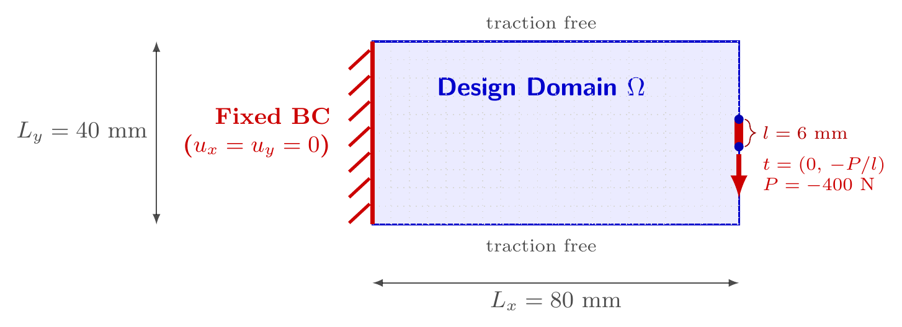

# CantileverMiddlePatch2d

右端中部受区段均布牵引的二维悬臂梁。实现：[`benchmarks/cantilever.py`](../../../src/soptx/problems/benchmarks/cantilever.py)。

## 问题描述



区域默认为 $[0, 80] \times [0, 40]$ mm（长宽比 2:1），平面应力，默认 $E = 70000$ MPa，$\nu = 0.25$。

- **左边界**（$x = x_0$）：完全固支，$u_x = u_y = 0$。
- **右边界中部**：中点处的竖直合力 $P$（默认 $-400$ N，负值向下）分布于以中点为中心、宽
  `load_width` 的边界区间，均布牵引强度 $\bar t = P / l$，其余部分零牵引。
- **顶、底边界**：自由，零牵引。

**载荷经过正则化处理。** 经典基准在右边界中点施加集中力 $P$，本模型把它按物理特征尺度（接触宽度、
垫板长度）摊成宽 `load_width` 的区段均布牵引。原因是 Hu--Zhang 混合元把牵引作为应力法向迹强施加，
边界数据必须是边界上的函数，收不下 Dirac 型的集中力。图中蓝点是载荷区的两个端点。

## 使用示例

```python
from soptx.problems import CantileverMiddlePatch2d

problem = CantileverMiddlePatch2d(
    domain=(0.0, 80.0, 0.0, 40.0),
    P=-400.0,
    load_width=6.0,
    E=70000.0,
    nu=0.25,
    plane_type="plane_stress",
)
```
