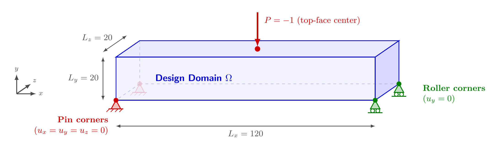

# FullMBBBeamPoint3d

两端底角点支承、顶面中心受集中力的完整三维 MBB 梁。实现：[`benchmarks/mbb.py`](../../../src/soptx/problems/benchmarks/mbb.py)。

## 问题描述



区域默认为 $[0, 120] \times [0, 20] \times [0, 20]$（长、高、宽之比 $6:1:1$），坐标轴 $x$、$y$、$z$
分别沿长、高、宽，$y$ 向上；三维线弹性，默认 $E = 1$，$\nu = 0.3$。不利用对称性，求整体模型。

- **左端两底角点**（$x = x_0$，$y = y_0$，$z \in \{z_0, z_1\}$）：铰支，$u_x = u_y = u_z = 0$。
- **右端两底角点**（$x = x_1$，$y = y_0$，$z \in \{z_0, z_1\}$）：滚支，$u_y = 0$。
- **顶面中心**（$x = (x_0 + x_1)/2$，$y = y_1$，$z = (z_0 + z_1)/2$）：竖直集中力 $P$（默认 $-1$，
  负值向下）。
- **其余边界**：自由，零牵引。

## 使用示例

```python
from soptx.problems import FullMBBBeamPoint3d

problem = FullMBBBeamPoint3d(
    domain=(0.0, 120.0, 0.0, 20.0, 0.0, 20.0),
    P=-1.0,
    E=1.0,
    nu=0.3,
)
```
