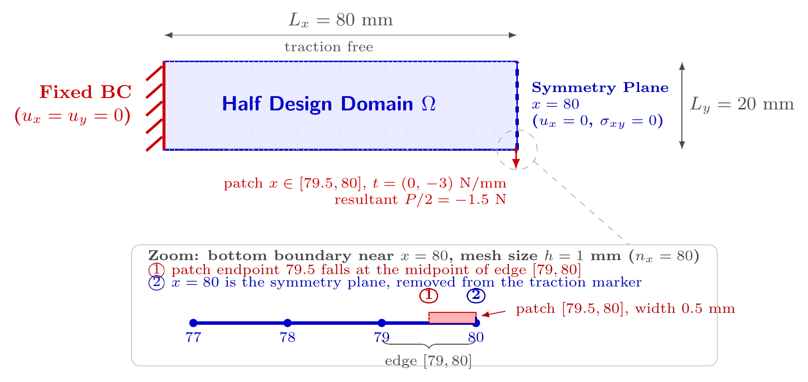

# HalfFixedFixedBeamPatch2d

两端固支梁底边中点受区段均布牵引问题的左半域对称降维模型。实现：[`benchmarks/fixed_fixed.py`](../../../src/soptx/problems/benchmarks/fixed_fixed.py)。

## 问题描述



完整梁为 $160 \times 20$ mm，两端固支，底边中点受竖直局部牵引，几何与载荷关于竖直中线 $x = 80$
对称，本类只取左半域。`domain` 默认为 $[0, 80] \times [0, 20]$ mm，对称面位于 $x = x_1$；平面应力，
默认 $E = 30$ MPa，$\nu = 0.4$。

- **左边界**（$x = x_0$）：完全固支，$u_x = u_y = 0$。
- **对称面**（$x = x_1$）：法向位移 $u_x = 0$，切向牵引 $\sigma_{xy} = 0$。Lagrange 位移元把 $u_x = 0$
  作为 Dirichlet 条件；Hu--Zhang 混合元只强加切向牵引 $\sigma_{nt} = 0$、法向牵引保持自由，$u_n = 0$
  随之自然满足（`is_symmetry_boundary`）。
- **底边对称面底端**：完整梁的竖直合力 $P$（默认 $-3$ N，负值向下）分布于以 $x = x_1$ 为中心、名义宽
  `load_width`（默认 $1$）的区间，强度 $\bar t = P / l$；半域只保留其左半边 $[x_1 - l/2,\ x_1]$，
  合力自动为 $P/2$。底边其余部分零牵引。
- **顶边**：自由，零牵引。

半域合力是完整结构的一半，柔顺度也是完整结构的一半，报告完整结构柔顺度时乘以 $2$。

**载荷经过正则化处理。** 与 [`CantileverMiddlePatch2d`](cantilever-middle-patch-2d.md) 相同，底边中点的
集中力按物理特征尺度摊成宽 `load_width` 的区段均布牵引，使 Hu--Zhang 混合元能把它作为应力法向迹
强施加。

**载荷区左端点通常不在网格节点上。** 半域载荷区宽 $l/2$，默认 $0.5$ mm；在 $h = 1$ mm 的网格上，
左端点 $x = 79.5$ 落在底边 $[79, 80]$ 的中点（图中放大部分的 ①），按整边选取的阶跃牵引在该边内
跳变，两条离散路径都表示不出来，分析器构造时的对齐检查会直接报错（见
[`README.md`](README.md) D 组"检查一"）。此时用 `traction` 参数注入
`soptx.fem.project_patch_traction_to_p1_trace` 投影出的连续 P1 迹载荷：区间常值牵引被精确 $L^2$
投影到底边的连续 P1 迹空间，合力精确保持，几何、材料与边界标记都不变，Lagrange 位移元与
Hu--Zhang 混合元由此看到同一个离散载荷泛函。

载荷区右端点与对称面 $x = x_1$ 重合，而对称面被排除在牵引标记之外（图中放大部分的 ②）。牵引标记
按边重心判定，底边 $[79, 80]$ 的重心在 $x = 79.5$，仍属牵引边，载荷不会因对称面的排除项而丢失
（D 组"检查二"）。

## 使用示例

先按原始问题取载荷区几何，再把牵引换成 P1 迹投影后重建问题；`n_cells` 须等于网格在 $x$ 方向的
剖分数：

```python
from soptx.fem import project_patch_traction_to_p1_trace
from soptx.mesh import TriangleMesh
from soptx.problems import HalfFixedFixedBeamPatch2d

nx, ny = 80, 20
problem = HalfFixedFixedBeamPatch2d(P=-3.0, load_width=1.0, E=30.0, nu=0.4,
                                    plane_type="plane_stress")
x0, x1, _, _ = problem.domain
traction = project_patch_traction_to_p1_trace(
    line=(x0, x1), n_cells=nx, level=problem.traction_level,
    patch=problem.traction_patch, intensity=problem.traction_intensity,
    axis=problem.traction_axis,
)
problem = HalfFixedFixedBeamPatch2d(P=-3.0, load_width=1.0, E=30.0, nu=0.4,
                                    plane_type="plane_stress", traction=traction)
mesh = TriangleMesh.from_checkerboard_box(box=problem.domain, nx=nx, ny=ny)
```
