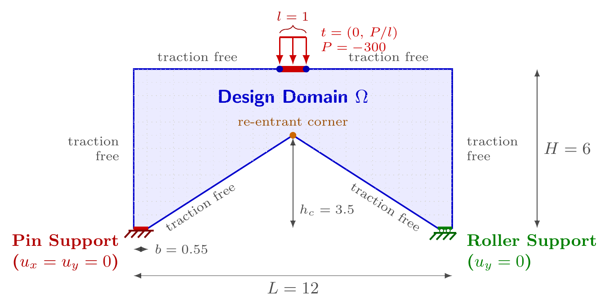

# PortalFramePatch2d

顶边中部受区段均布牵引的二维门式框架。实现：[`benchmarks/portal_frame.py`](../../../src/soptx/problems/benchmarks/portal_frame.py)。

## 问题描述



设计域是 $L \times H$ 矩形去掉底边中央的三角形缺口，缺口顶点为 $(b, 0)$、$(L/2, h_c)$、
$(L - b, 0)$，整体为七边形（顶点见 `vertices`），`domain` 取其包围盒 $(0, L, 0, H)$。默认
$L = 12$，$H = 6$，$b = 0.55$，$h_c = 3.5$，平面应力，$E = 100000$，$\nu = 0.25$。

- **左支座段**（$y = 0$，$x \in [0, b]$）：固定铰，$u_x = u_y = 0$。
- **右支座段**（$y = 0$，$x \in [L - b, L]$）：滚动铰，$u_y = 0$。Hu--Zhang 混合元中只强加切向
  牵引 $\sigma_{nt} = 0$，法向位移 $u_n = 0$ 随之自然满足。
- **顶边中部**：竖直合力 $P$（默认 $-300$，负值向下）分布于以 $x = L/2$ 为中心、宽 `load_width`
  （默认 $1$）的区间，均布牵引强度 $\bar t = P / l$。
- **其余边界**（左边、右边、顶边其余部分、两条斜边）：自由，零牵引。

几何与载荷关于 $x = L/2$ 对称，但左铰右滚的支座不对称，因此必须求全域，不能取半域加对称面。

**载荷经过正则化处理。** 本模型把顶边中点的集中力按物理特征尺度摊成宽 `load_width` 的区段均布
牵引。原因是 Hu--Zhang 混合元把牵引作为应力法向迹强施加，边界数据必须是边界上的函数，收不下
Dirac 型的集中力。图中蓝点是载荷区的两个端点。

## 使用示例

```python
from soptx.problems import PortalFramePatch2d

problem = PortalFramePatch2d(
    L=12.0,
    H=6.0,
    P=-300.0,
    load_width=1.0,
    b=0.55,
    h_c=3.5,
    E=100000.0,
    nu=0.25,
    plane_type="plane_stress",
)
```
