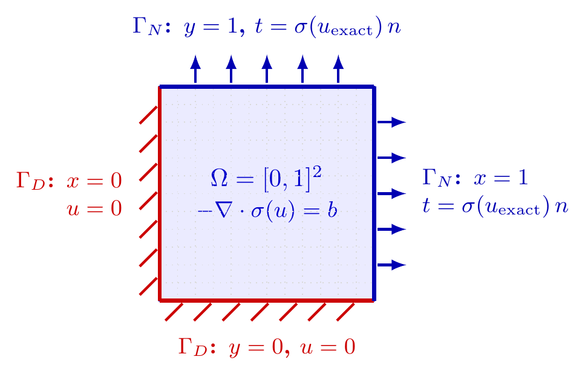

# MixedBoundarySinusoidalElasticity2D

单位正方形上的混合边界正弦制造解，位移两分量相同；论文 5.1 节收敛阶验证的模型。实现：[`manufactured/sinusoidal.py`](../../../src/soptx/problems/manufactured/sinusoidal.py)。

## 问题描述



区域固定为 $[0, 1]^2$，平面应变，材料以 Lamé 常数给出，默认 $\lambda = 1$，$\mu = \tfrac12$（构造参数 `lame_lambda`、`shear_modulus`）。

- **位移边界** $\Gamma_D = \{x = 0\} \cup \{y = 0\}$：齐次位移 $u = 0$（精确位移在这两条边上恒为零）。
- **牵引边界** $\Gamma_N = \{x = 1\} \cup \{y = 1\}$：施加精确应力的法向迹 $t = \sigma n$，右边 $t = (\sigma_{xx}, \sigma_{xy})$，顶边 $t = (\sigma_{xy}, \sigma_{yy})$。
- **体力**：$b = -\nabla\cdot\sigma(u_\mathrm{exact})$，作用于全域。

四个角点处精确应力均为零（$\sin(\pi x)\sin(\pi y)$ 的导数在角点处含 $\sin 0$ 或 $\sin\pi$ 因子）；$(1, 1)$ 是唯一的牵引–牵引角点，两条边的法向分别为 $(1, 0)$ 与 $(0, 1)$，角点处的牵引值也为零。

## 精确解与体力

记

$$
s = \sin(\pi x)\sin(\pi y),\qquad
a = \pi\cos(\pi x)\sin(\pi y),\qquad
c = \pi\sin(\pi x)\cos(\pi y),
$$

精确位移与应力为

$$
u = (s, s)^\mathsf{T},\qquad
\sigma =
\begin{pmatrix}
(\lambda + 2\mu)a + \lambda c & \mu(a + c)\\
\mu(a + c) & \lambda a + (\lambda + 2\mu)c
\end{pmatrix}.
$$

应力散度的两个分量相同，

$$
(\nabla\cdot\sigma)_1 = (\nabla\cdot\sigma)_2
= \pi^2\left[(\lambda + \mu)\cos(\pi x)\cos(\pi y) - (\lambda + 3\mu)\sin(\pi x)\sin(\pi y)\right],
$$

体力取 $b = -\nabla\cdot\sigma$。类上 `disp_solution`、`grad_disp_solution`、`stress_solution`（Voigt 顺序 $(\sigma_{xx}, \sigma_{xy}, \sigma_{yy})$）与 `div_stress_solution` 分别给出以上各量。

## 使用示例

```python
from soptx.mesh import TriangleMesh
from soptx.materials import IsotropicLinearElasticMaterial
from soptx.problems import MixedBoundarySinusoidalElasticity2D

problem = MixedBoundarySinusoidalElasticity2D(lame_lambda=1.0, shear_modulus=0.5)
material = IsotropicLinearElasticMaterial(
    lame_lambda=problem.lam,
    shear_modulus=problem.mu,
    hypothesis=problem.plane_type,
)
mesh = TriangleMesh.from_checkerboard_box(box=problem.domain, nx=16, ny=16)

body_force, traction = problem.loads()      # BodyForceLoad, BoundaryTractionLoad
```
