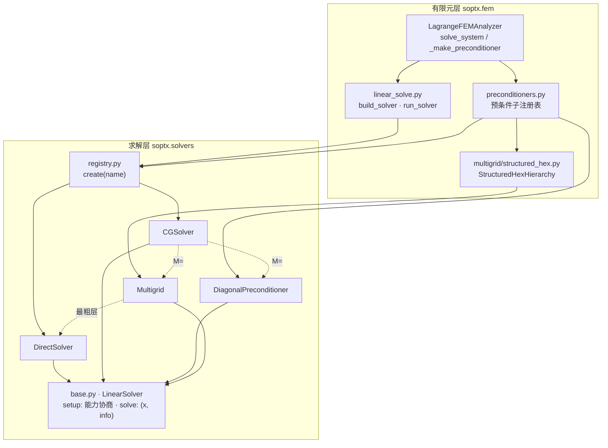

# 求解层架构

本文说明 SOPTX 线性求解的整体结构: `soptx.solvers` 的统一契约、求解层与有限元层的分工、
两张注册表, 以及各分析器如何接入。各类求解器的细节见同目录的
[`direct.md`](direct.md)、[`iterative.md`](iterative.md) 与 [`preconditioners.md`](preconditioners.md)。

参数与默认值以源码 docstring 为事实源, 本目录只记录架构、设计决策与模块间关系。

术语: SPD 指对称正定 (symmetric positive definite), 即 $A = A^{\mathsf T}$ 且对任意非零
$x$ 有 $x^{\mathsf T} A x > 0$; 对称不定指对称但特征值有正有负, 如鞍点系统。

## 分层

| 层 | 职责 | 不做什么 |
|---|---|---|
| 求解层 `soptx.solvers` | 纯代数: 求解器、预条件子、光滑子、多重网格循环 | 不认识网格与函数空间; 多重网格的层次不从算子推导, 由外部传入 |
| 有限元层 `soptx.fem` | 按名字构造求解器与预条件子, 构造几何多重网格层次, 管理求解生命周期与诊断整理 | 不实现数值算法本身 |

依赖方向只能是有限元层依赖求解层, 由 `tools/check_architecture.py` 强制。这与 MFEM 的
`MultigridBase::AddLevel(Operator*, Solver*, ...)` 同构: 层次在离散侧装配, 求解层只跑循环。

## 包结构

| 模块 | 内容 | 状态 |
|---|---|---|
| `solvers/base.py` | `LinearSolver` 基类, 能力标签与探测, `SolveInfo` 契约, `ConvergedReason` | 已实现 |
| `solvers/registry.py` | `register` / `create` / `available` | 已实现 |
| `solvers/direct.py` | `DirectSolver`, 函数式 `spsolve` | 已实现 |
| `solvers/cg.py` | `CGSolver`, 函数式 `cg` | 已实现 |
| `solvers/preconditioners.py` | `DiagonalPreconditioner`, `JacobiSmoother`, `estimate_lambda_max` | 已实现 |
| `solvers/multigrid.py` | `Multigrid`, `MultigridLevel` (V 循环) | 已实现 |
| `fem/linear_solve.py` | `build_solver`, `run_solver`, `as_iterative_operator` | 已实现 |
| `fem/preconditioners.py` | 预条件子注册表 | 已实现 |
| `fem/multigrid/structured_hex.py` | `StructuredHexHierarchy` | 已实现 |

占位类的构造函数抛 `NotImplementedError`, 未登记到注册表。对外只暴露各包 `__init__.py`
导出的名字。

## 统一契约 `LinearSolver`

直接法、Krylov 迭代、预条件子、光滑子与多重网格都是 `LinearSolver`
(`solvers/base.py`), 区别只在 `setup` 需要算子提供什么, 不在接口形状。

| 成员 | 说明 |
|---|---|
| `requires` | `setup` 需要算子提供的能力标签集合 |
| `setup(op)` | 能力协商后绑定算子; 直接法在此分解, 多重网格在此绑定各层 |
| `solve(b, x0=None)` | 返回 `(x, info)`, 由基类校验 `info` 契约 |
| `__matmul__(r)` | 预条件子模式: 零初值求解一次; 开销敏感的子类覆盖它走直算路径 |

统一之后, `M=` 位、多重网格的光滑子位与最粗层位都可以填任意 `LinearSolver`。组合是否
合法由调用点负责, 包内不预设; 合法性的数学条件见下文「组合约束」。

### `info` 契约

| 键 | 说明 |
|---|---|
| `niter` | 迭代次数; 直接法记 1 |
| `relres` | 真残差 $\|b - Ax\| / \|b\|$; 无法廉价得到时为 `None`, 不是 0 |
| `converged` | 是否按判据正常退出 |
| `reason` | 可选, `ConvergedReason`, 取值沿用 PETSc `KSPConvergedReason`; `reason > 0` 与 `converged` 必须一致 |

### 能力协商

| 标签 | 探测方式 | 需要它的求解器 |
|---|---|---|
| `CAP_MATRIX` | 算子有 `to_scipy` 或 `tocsr` | `DirectSolver` |
| `CAP_DIAGONAL` | 算子有 `diagonal` 或 `tocoo`; 刻意不认 `diags()`, 它返回稀疏矩阵而不是一维向量 | `DiagonalPreconditioner`, `JacobiSmoother` (均为未显式给对角时) |
| `CAP_HIERARCHY` | 保留 | 暂无 |

`setup` 缺能力时抛 `OperatorCapabilityError`。这取代了在分析器里按 `operator_level`
硬编码的分支: 'ea' 层级的 matrix-free 算子只支持 `@`, 直接法在其上于 `setup` 处被拒。

## 注册表

两张注册表都只造未 `setup` 的实例, 能不能用在 `setup` 里协商。两张表都不设别名。

| 注册表 | 位置 | 键 | 为什么在这一层 |
|---|---|---|---|
| 求解器 | `soptx.solvers.registry` | `scipy`, `mumps`, `cg` | 构造只需要构造参数 |
| 预条件子 | `soptx.fem.preconditioners` | `jacobi`, `gmg`, `scipy`, `mumps` | `gmg` 要用分析器状态 (单元系数, Dirichlet 掩码, 层次缓存), 求解层造不出它 |

预条件子工厂的签名为 `(analyzer, options) -> LinearSolver`, 由 `LagrangeFEMAnalyzer` 按
`solver_options['precond']` 查表。

## 组合约束

PCG 要求预条件子 $M^{-1}$ 是**线性**、**对称**、**正定**的算子:

- 线性: 预条件子内部不能带自适应终止。Krylov 求解器的输出对右端项是非线性的, 即使
  固定步数也一样, 因此不能填进 CG 的 `M=` 位; 嵌套 Krylov 需要 flexible CG 或 FGMRES,
  SOPTX 目前没有。
- 对称: 多重网格要求前后光滑次数相同, 光滑子关于 $A$ 内积自伴, 最粗层精确求解。
- 正定: 违反时 CG 因 $r^{\mathsf T} M^{-1} r < 0$ 以 `DIVERGED_INDEFINITE_PC` 停机。

`cg.py` 不预先检查这三条; 已实现的三类预条件子都满足, 见
[`preconditioners.md`](preconditioners.md)。

## 分析器接入

| 分析器 | 状态方程 | 可用 `solve_method` | 默认 | 求解路径 |
|---|---|---|---|---|
| `LagrangeFEMAnalyzer` | SPD | `'fa'`: `'scipy'` / `'mumps'` / `'cg'`; `'ea'`: `'cg'` | `'mumps'` | `solve_system` → `linear_solve.build_solver` / `run_solver`; 预条件子经注册表 |
| `SubstructureAnalyzer` | SPD (接口系统) | `'cg'` / `'scipy'` / `'mumps'` | `'cg'` | `fem/substructure/solve.py` 自行构造 `CGSolver` 与直接法; 预条件子用字符串 `'none'` / `'jacobi'` 或对象, 不经注册表 |
| `HuZhangMFEMAnalyzer` | 对称不定鞍点 | `'scipy'` / `'mumps'` | `'mumps'` | 自行 `create` 与 `close`; 对 `'cg'` 直接拒绝, 迭代路径待 MINRES 与鞍点块预条件子 |

`compliance.py` 在 `HuZhangMFEMAnalyzer` 且 `state_variable='u'` 时用 `create('mumps')`
解一次应力矩阵。

`linear_solve.py` 承载有限元层的求解策略: 有限元层的 CG 默认值 (与求解层分两层, 见
[`iterative.md`](iterative.md)「默认值」), 带预条件子时 CG 改在 $\|r\|_2$ 下停机并开启
收敛时的真残差验证, 求解后释放直接法的分解与 MUMPS 上下文, 把 `info` 整理成统一的
诊断字典。

**待整理**: 同一套"构造、`setup`、求解、释放"流程目前分散在 `linear_solve.py`、
Hu–Zhang 分析器与子结构路径 3 处, "带预条件子即改用 $\|r\|_2$ 判据"也在子结构路径重复
写死。计划让三个分析器共用 `linear_solve.py`。

## 开放的设计问题

| 问题 | 现状 | 方向 |
|---|---|---|
| AMG 的位置 | 未实现; 原 `AMGSolver` 占位按自带循环的独立求解器设计, 已删除 | 实现时做成"代数层次构造器", 与几何层次一样喂给同一个 `Multigrid`, 不再有第二套 V 循环 |
| GMG 的后端 | `StructuredHexHierarchy` 内部用 `scipy.sparse` 构造延拓与粗层, 只支持 numpy 后端 | 随 GPU 计划去掉对 scipy 的绑定 |
| 线性与非线性求解器 | 类型系统不区分, CG 可被误填进 `M=` 位 | 至少在文档中写明; 是否加类型标记待定 |
| 公开 API 中的占位类 | 已解决: `ChebyshevSmoother`, `AMGSolver`, `MINRESSolver` 占位均已删除, 未实现的方法只在文档中记录 | — |
| 文件命名 | `solvers/preconditioners.py` 只含一个预条件子, 且与 `fem/preconditioners.py` 同名 | 待定 |

## 与 MFEM, PETSc, FEALPy 的关系

- 统一 `Solver` 类型与外部装配的多重网格层次借自 MFEM; CG 的停机判据对齐 MFEM `CGSolver`。
- `norm_type`, `divtol` 与 `ConvergedReason` 借自 PETSc `KSP` 的语义, 不依赖 PETSc 代码。
- `direct.py` 与 `cg.py` 以 FEALPy `fealpy/solver/` 为参考重新设计, 来源与许可证见
  [`THIRD_PARTY_NOTICES.md`](../../THIRD_PARTY_NOTICES.md)。FEALPy 覆盖更广 (GMRES,
  BiCGStab, MINRES, GAMG, 加性 Schwarz 等), SOPTX 只保留 SPD 主线需要的部分。

分布式/MPI 求解 (`weighted_cg`, CG 的 `dot_product` 扩展) 已移出主线, 见
[`docs/archive.md`](../archive.md)。

## 测试与示例

| 路径 | 覆盖 |
|---|---|
| `tests/unit/test_solvers_direct*.py` | `spsolve`, `DirectSolver` |
| `tests/unit/test_solvers_cg*.py` | `cg`, `CGSolver` |
| `tests/unit/test_multigrid_solver.py` | `JacobiSmoother`, `estimate_lambda_max`, `Multigrid` (一维 Poisson) |
| `tests/unit/test_multigrid_structured_hex.py` | `StructuredHexHierarchy`, MGCG 与直接法同解, 分析器 `precond='gmg'` |
| `tests/unit/test_fem_preconditioners.py` | 预条件子注册表 |
| `tests/integration/test_lagrange_fem_analyzer_*_level.py` | `operator_level` 与 `preconditioner_level` 两根轴 |
| `examples/linear_solvers/` | 直接法与 CG 的算法正确性验证 |

> 机器相关的运行环境配置 (如 MPI ABI) 不在本仓库文档范围, 见各机器的环境说明。
